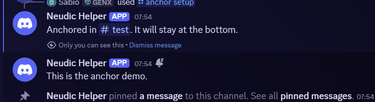
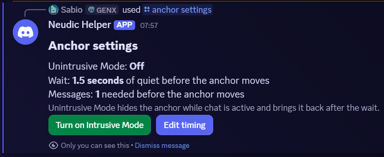
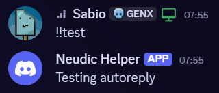
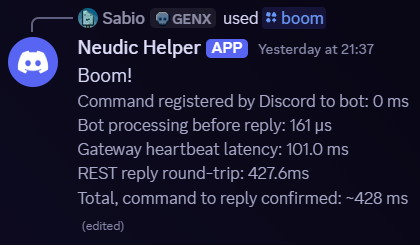
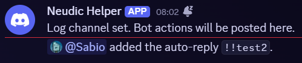
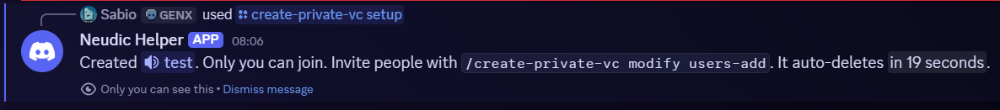

# rusty

Rusty is a Discord bot made with the programming language Rust. This was made as an experiment by me to attempt to use Rust for the first time! This bot is in early development stages with semi-frequent updates.

## Features

### Anchor



Anchors the message to the bottom of the screen, similar to Slack Extra's system. It has multiple configurations. May not be suitable for highly active servers with a significantly high amount of users.



### Autoreply



Autoreplies text that have already been preset'd.

### Boom



Boom is rusty's equivalent of ping, which is the more common term in other Discord bots.

### Disappearing


Basically WhatsApp's system of disappearing messages, but in Discord! May not be suitable for highly active servers with more than 1000 messages per day. I don't know how to feature a screenshot for this demo, so you'll just have to try it out yourself :)

### Log Channel



Bot logs go to this channel! (and daily summaries!)

### Private VC



### Redirect

Pinging me redirects the ping to another user.

### Remind Me

Tell me to remind you something at a specific time.

### Usage

Checks the usage of rusty. (CPU & RAM usage)

## Run it with rusty

We currently don't offer server hosting for rusty. Self-hosting it is required for now.

## Run it yourself (self-host)

### 1. Create a Discord Application

1. Go to the [Discord Developer Portal](https://discord.com/developers/applications) and create a **New Application**.
2. Open the **Bot** tab, then **Reset Token** and copy it. Save this somewhere secure.
3. Enable **Message Content Intent** in the same tab you're in. It's under **Privileged Gateway Intents**.
4. Open **OAuth2**, then in the **OAuth2 URL Generator** section, check the scopes `bot` and `applications.commands`, and give it permissions its command need (Send Messages, Manage Messages, Manage Channels).
5. Open the generated URL to invite the bot to your server.

### 2. Get the bot

**Option A: download a release (no Rust needed)**

Grab the binary for your OS from the [Releases](https://github.com/SabioOfficial/rusty/releases) page.

On Linux/macOS, make it executable:

```bash
chmod +x rusty-*
```

**Option B: build from source**

Requires Rust 1.85+.

```bash
git clone https://github.com/SabioOfficial/rusty.git
cd rusty
cargo build --release
```

The binary is located at `target/release/rusty` (`rusty.exe` on Windows).

### 3. Add your token

In the folder you'll run the bot from, create a `.env` file:

```bash
cp .env.example .env
```

Then set your token in it. It should be self explanatory as the .env.example template explains what you have to do very well.

### 4. Run it

```bash
./rusty
```

You should see `rusty online`. Sometimes it may take a Discord refresh (Ctrl + R on the desktop app) to view the commands.

### Notes

* The bot saves its state with text files where it's launched from. Always start it from the same folder, or you'll lose your settings. This will be changed in the future to use a database.

## Roadmap

Everything planned for the next release!

**Key:**

- [ ] Todo
- [X] Done

**Actual Roadmap:**

- [ ] Use Database instead of text files
- [ ] Make it easier to input the token
- [X] Customizable level of inactivity for the anchor (how many messages, how long)
- [X] Custom !! thingy
- [ ] Private vcs should have an admin-only setting to change what category the vcs spawn in
- [X] Stop using InteractionResponseDataBuilder as it is deprecated
- [X] Remind me command 
